# ApplyPilot ★ — your job hunt, on autopilot

ApplyPilot is a Windows desktop app that searches **every job board at once**, ranks each job against **your resume**, and fills in applications for you — running **several role-specific campaigns in parallel**, each with its own resume.

- **25+ live job sources**: 12 free APIs/feeds (Himalayas, Remote OK, We Work Remotely, Arbeitnow, Jobicy, The Muse, HN Who's Hiring, 4 Day Week, Rise, No Fluff Jobs, jobdata, Working Nomads…), **729 verified company career pages** on Greenhouse, Lever, Ashby, Workable, SmartRecruiters & Recruitee (Razorpay, CRED, Meesho, Swiggy, Groww, Freshworks, Anthropic, OpenAI…), plus optional keyed sources: JSearch (LinkedIn / Indeed / Glassdoor / ZipRecruiter via Google for Jobs), Adzuna (India + 18 countries), Jooble, Reed, USAJOBS, Careerjet, SerpApi, Findwork.
- **252 job platforms directory** with one-click deep-linked searches (Naukri, LinkedIn, foundit, Instahyre, Cutshort, Wellfound, Internshala, Indeed, Glassdoor, Seek, Bayt, government boards, freelance, and "hidden job" Google ATS tricks).
- **Parallel campaigns** — one per target role, each with its own resume, filters, schedule, minimum match score and daily cap.
- **Multiple resumes** — upload by drag & drop (PDF/DOCX/TXT, duplicates detected, robust PDF reading for Canva/Word/LaTeX exports), tag resumes by role; ApplyPilot sends the best one for every job and A/B-tests which resume gets interviews.
- **Explainable match score** — title, skills, experience, location and freshness, with matched/missing skills and ghost-job/scam flags.
- **Auto-apply engine** — fills Greenhouse, Lever, Ashby, Workable, SmartRecruiters and Recruitee forms in your own Edge/Chrome (separate profile). LinkedIn, Indeed, Naukri & others use *assisted mode*: we fill, you click submit (their terms forbid bots).
- **Answer bank** — screening questions are answered from your profile, your saved answers, or AI only when the answer is clearly supported. Unknown questions pause and wait for you — nothing is guessed.
- **AI studio (Claude, bring-your-own key)** — ATS score + missing keywords + truthful bullet rewrites, tailored cover letters, interview-prep packs, recruiter messages.
- **Tracker** — drag-and-drop pipeline (Saved → Applied → Interview → Offer), notes, follow-up reminders, proof screenshots, CSV export.
- **Private by design** — all data stays on your PC; API keys are encrypted with Windows DPAPI; one click exports or deletes everything.

## Screenshots

| | |
|---|---|
| 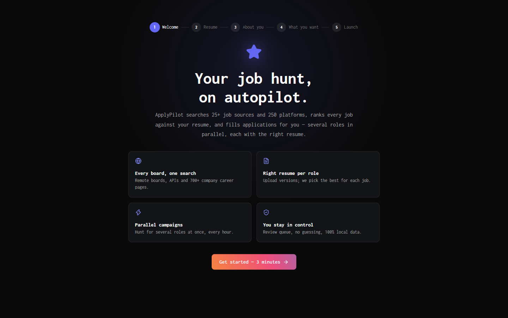 **Onboarding** — 3-minute setup, 7-day Pro trial | 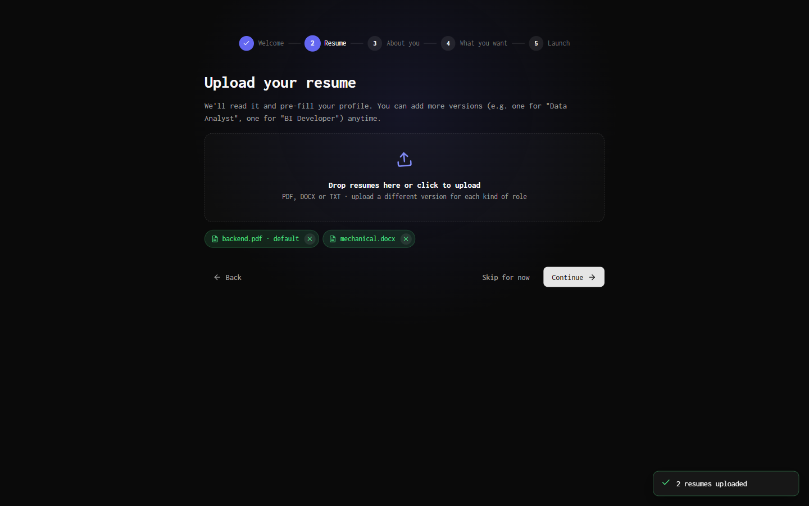 **Resume upload** — drag & drop, remove any file with × |
| 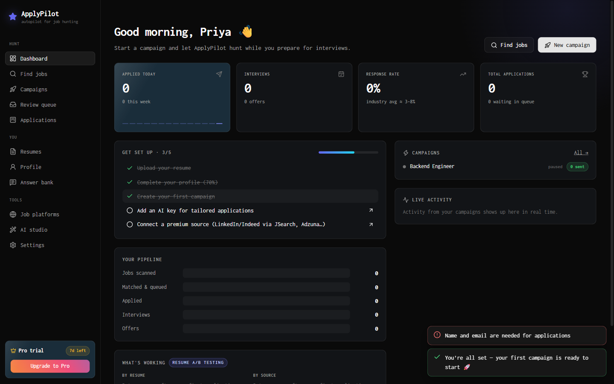 **Dashboard** — stats, pipeline, live activity | 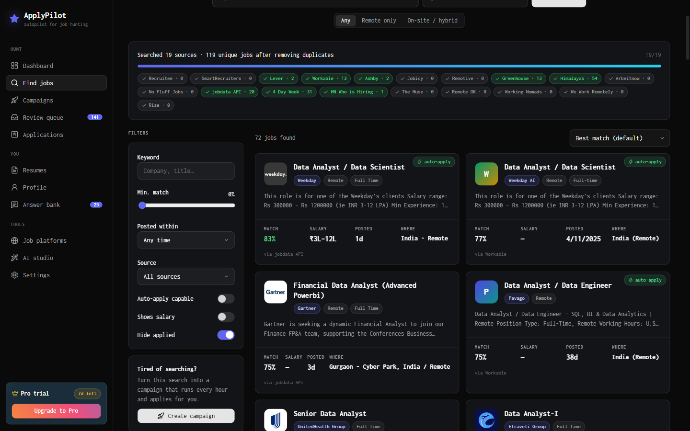 **Find jobs** — 19 sources searched in parallel, ranked by match |
| 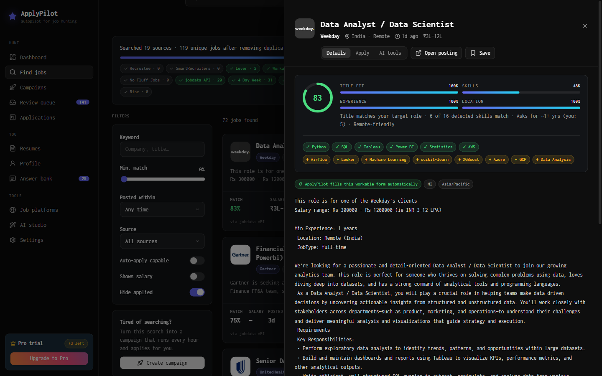 **Job detail** — explainable match score, matched / missing skills | 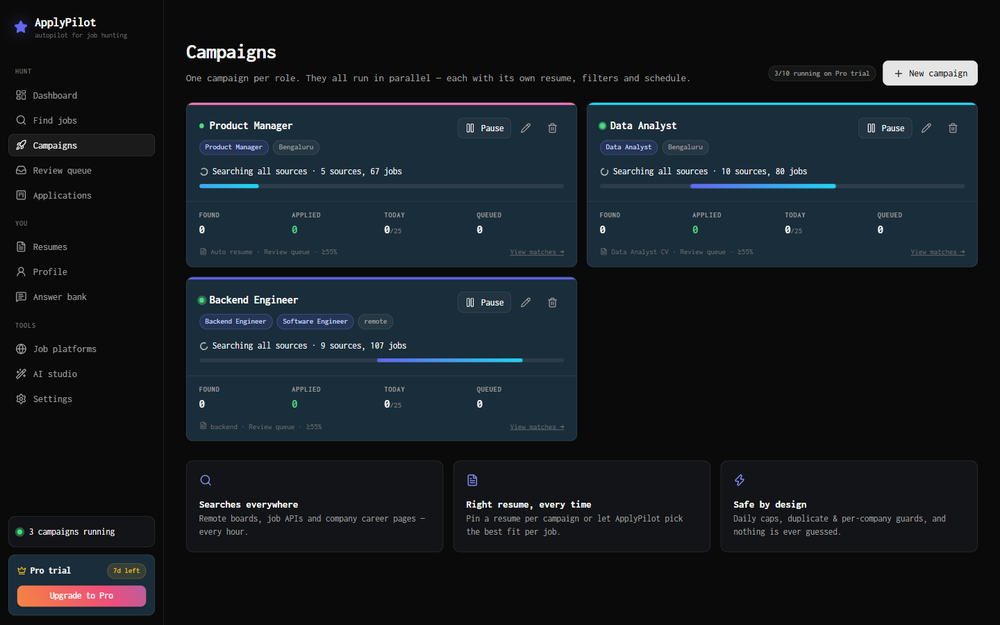 **Parallel campaigns** — one per role, each with its own resume |
| 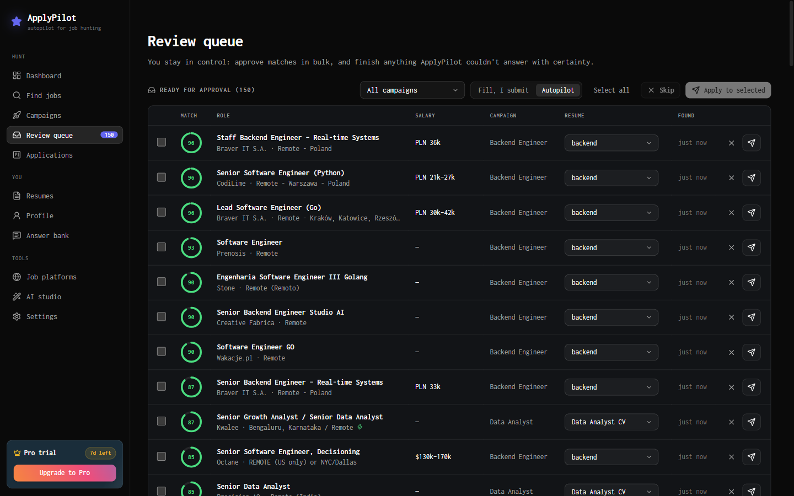 **Review queue** — approve matches in bulk, filter by campaign | 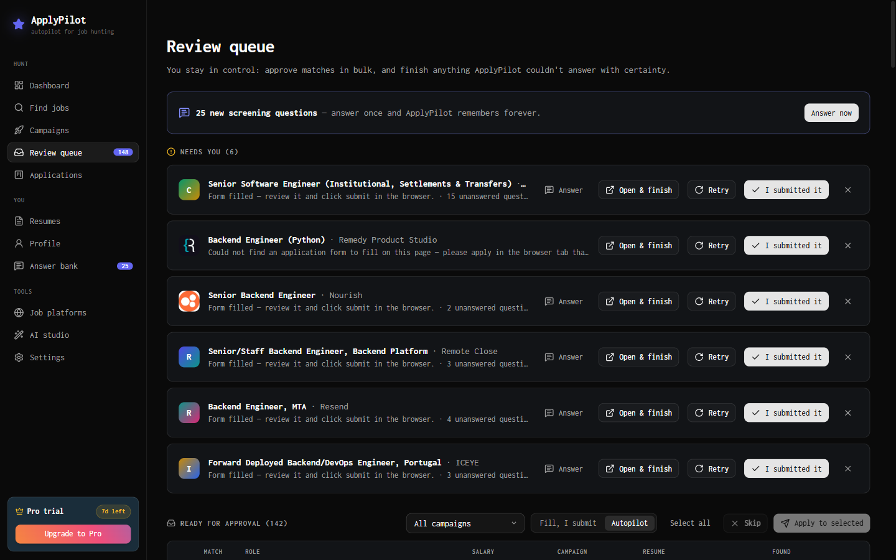 **Needs you** — pre-filled forms waiting for your submit |
| 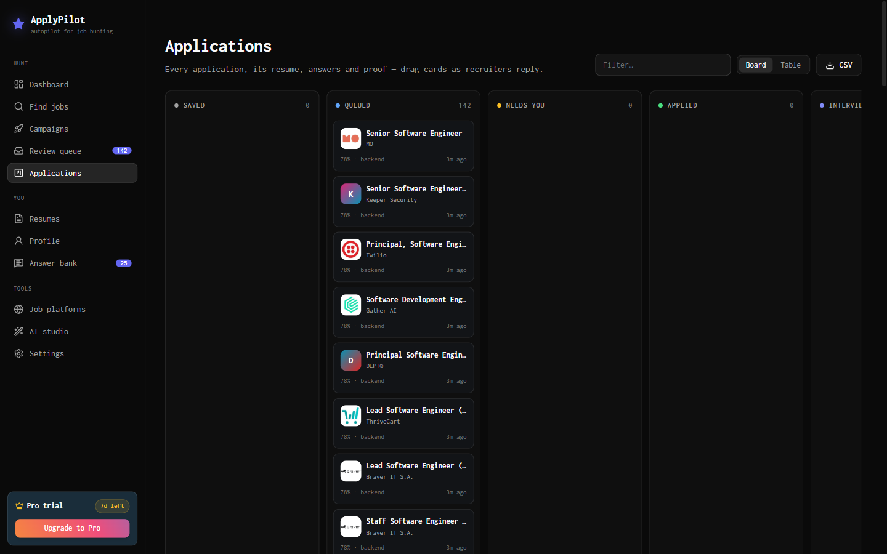 **Applications** — drag-and-drop pipeline with proof | 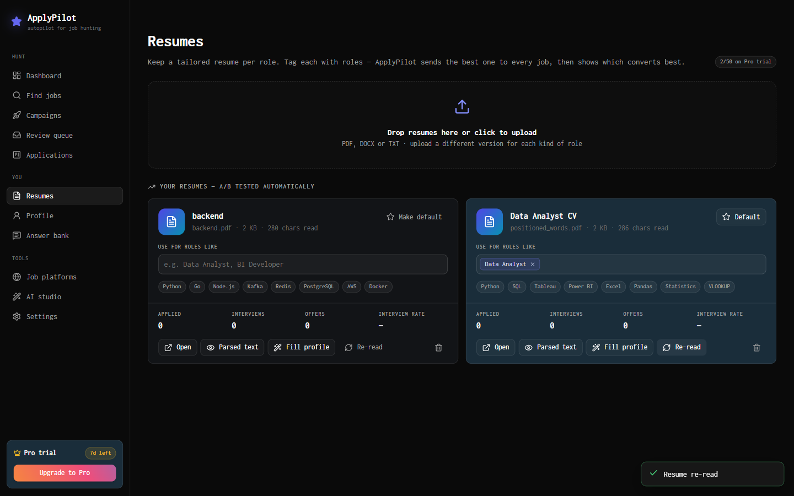 **Resumes** — role tags, re-read, per-resume interview rate |
| 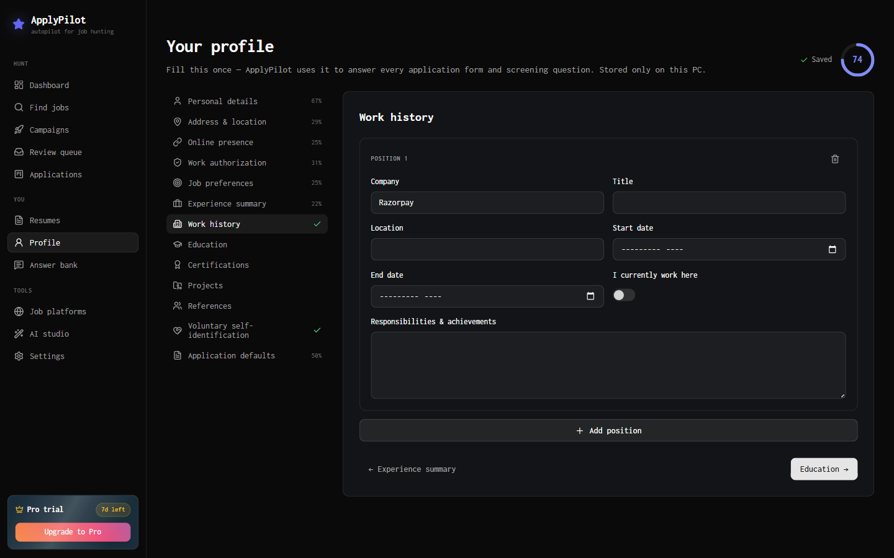 **Profile** — 13 sections that answer every form | 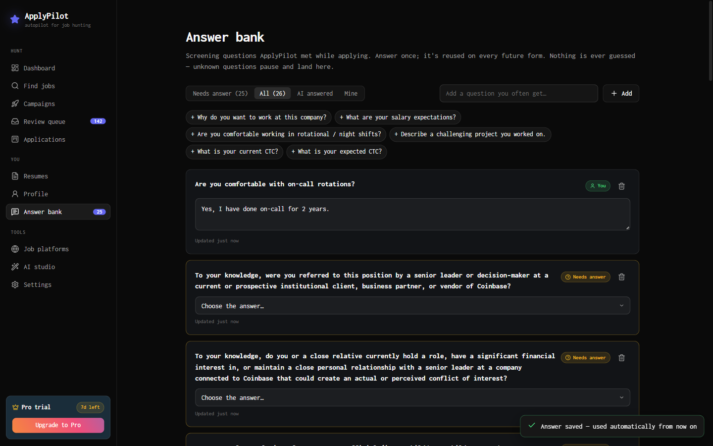 **Answer bank** — answer a screening question once, reuse forever |
| 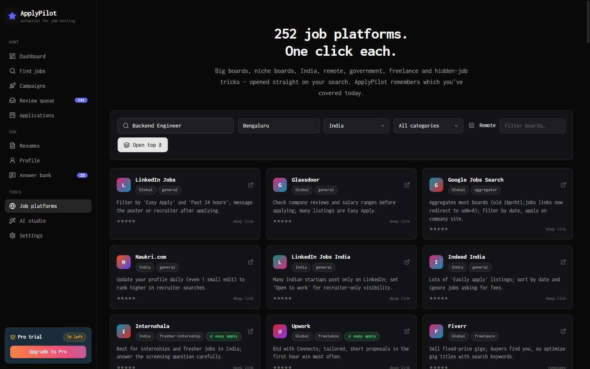 **252 job platforms** — one-click deep-linked searches | 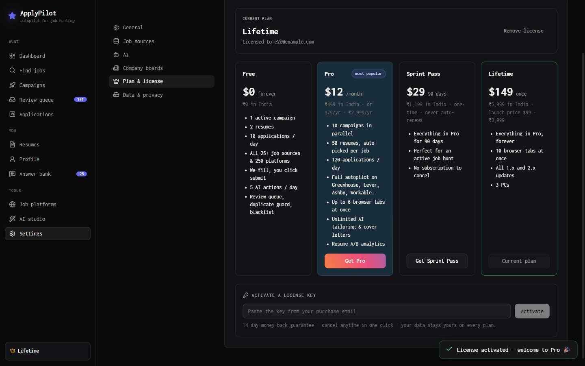 **Plans & licensing** — Free, Pro, Sprint, Lifetime |
| 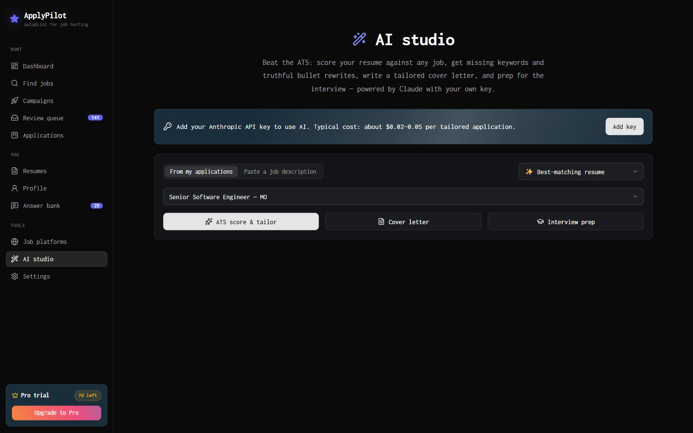 **AI studio** — ATS score, tailoring, cover letters (your Claude key) | 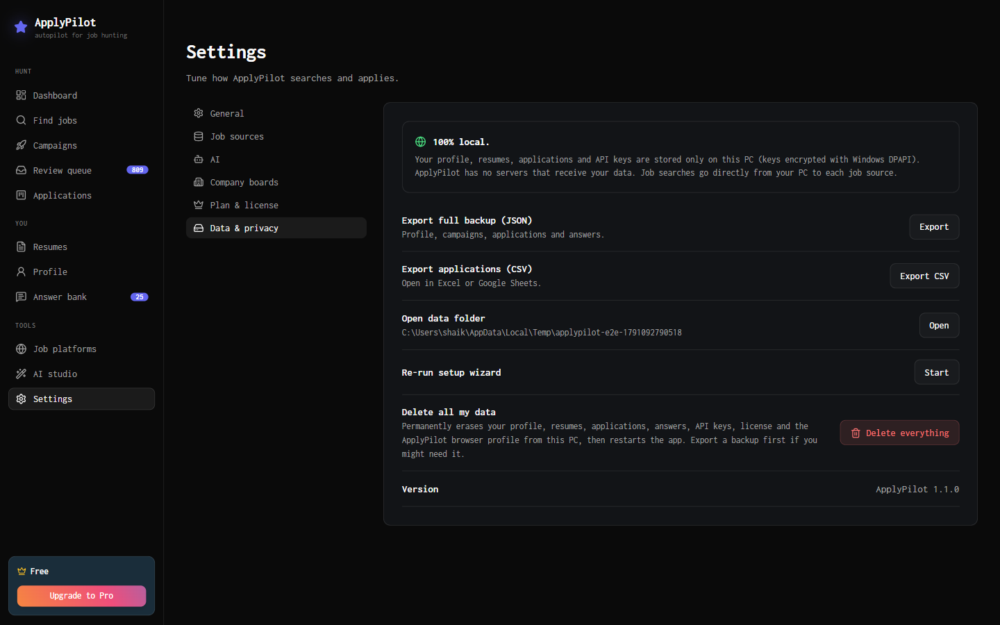 **Data & privacy** — export or delete everything |

## Run from source

```bash
npm install
```

```bash
npm start
```

`npm start` builds the UI and launches Electron. For hot-reload UI development use `npm run dev`.

> npm 11 blocks install scripts by default. If Electron didn't download, run `node node_modules/electron/install.js` once.

## Build the Windows installer

```bash
npm run dist
```

This produces `release/ApplyPilot-Setup-<version>.exe` (~115 MB NSIS installer, per-user, desktop + Start-menu shortcuts). Re-installing over an existing install keeps the same path, so taskbar pins keep working. `npm run dist:portable` builds a single portable `.exe`.

Requirements on the user's PC: Windows 10/11 and Microsoft Edge (pre-installed on Windows) or Google Chrome — ApplyPilot drives the browser that's already installed, so the installer stays small.

## Testing

```bash
node scripts/e2e.js
```

51 end-to-end checks through the real UI on a throwaway profile. They cover onboarding and uploads, parallel campaigns, parallel applying (never submits), the tracker, settings, licensing, a 3,000-application stress test, and "delete all data". Add `--exe release/win-unpacked/ApplyPilot.exe` to test the packaged build, or `--screenshots` to refresh the images above. See [docs/TESTING.md](docs/TESTING.md) for every layer (engine self-test, dry-runs, connector tests) and the latest results.

## Selling it (licensing)

See [docs/SELLING.md](docs/SELLING.md). In short:

- Free plan works out of the box; a 7-day Pro trial is offered during onboarding.
- **Online keys**: sell through **Dodo Payments** (India-friendly merchant of record). Keys are activated in-app via Dodo's public license API — no server needed. Name products with "Lifetime" / "Sprint" so the app maps them to the right plan.
- **Offline keys**: `npm run license:issue -- someone@example.com pro 365` signs a key with your private key in `keys/` (never commit or ship it — it's git-ignored).
- Put your checkout links in [`src/config.js`](src/config.js).

## Project layout

| Path | What |
|---|---|
| `electron/main.js` | App window, tray, IPC, notifications, follow-up reminders |
| `electron/campaigns.js` | Parallel campaign runner, duplicate & per-company guards, Q&A memory |
| `electron/connectors/` | One file per job source + `index.js` aggregator (dedupe across sources) |
| `electron/apply/` | Playwright auto-apply engine, ATS adapters, profile-based answerer |
| `electron/match.js` | Match scoring, skill extraction, ghost-job flags |
| `electron/resume.js` | PDF/DOCX/TXT parsing, profile extraction, best-resume picker |
| `electron/ai.js` | Claude-powered cover letters, tailoring, screening answers, interview prep |
| `electron/license.js` | Plans, trial, offline Ed25519 keys, Dodo Payments activation |
| `electron/data/` | Profile schema, 729 verified company boards, 252 job platforms |
| `src/` | React UI (Vite) — design inspired by trustmrr.com |
| `scripts/` | Connector tests, company-board verifier, license tool |
| `docs/` | Market research, job platform directory, selling guide |

## Documentation

| Doc | What's in it |
|---|---|
| [docs/ARCHITECTURE.md](docs/ARCHITECTURE.md) | How it works: process model, campaign data flow, connector contract, auto-apply engine, safety guarantees, licensing, storage, test helpers |
| [docs/SELLING.md](docs/SELLING.md) | Pricing, Dodo Payments setup, license keys, shipping the installer, signing, go-to-market |
| [docs/MARKET_RESEARCH.md](docs/MARKET_RESEARCH.md) | Competitors, user pain points, feature priorities, monetisation, legal/ToS risk (with sources) |
| [docs/JOB_PLATFORMS.md](docs/JOB_PLATFORMS.md) | The 252-platform directory, by region and category |
| [docs/TESTING.md](docs/TESTING.md) | Test layers, the 51 E2E checks, latest results, bugs the suite caught |
| [docs/STATUS.md](docs/STATUS.md) | What was verified end-to-end, known limitations, pre-launch checklist |
| [docs/PRIVACY.md](docs/PRIVACY.md) · [docs/TERMS.md](docs/TERMS.md) | Privacy policy and terms of use to publish with the app |
| [CONTRIBUTING.md](CONTRIBUTING.md) · [CHANGELOG.md](CHANGELOG.md) | Dev workflow and release notes |

## License

Proprietary — see [LICENSE](LICENSE).

## Responsible use

ApplyPilot is designed to keep job seekers out of trouble: review-first defaults, daily caps, max 2 applications per company per 30 days, no CAPTCHA solving, no automated logins, and no auto-submission on platforms whose terms forbid automation. Quality applications beat spam — recruiters notice.
