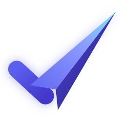

# ApplyPilot brand

 &nbsp; 

## The mark: "check-plane"

The logo is a **check mark whose long stroke is a folded paper plane taking off**.

- **The check:** the application is done, right, and verified, with nothing guessed.
- **The paper plane:** your application sent, and your career taking off. The "Pilot" in ApplyPilot.

It's built from three flat shapes: a rounded stroke and two plane faces. That keeps it minimal and crisp at 16 px. A soft gradient and a fold shadow make it feel rich rather than flat. As far as we know no job app uses this combination (paper planes and check marks are each common on their own).

## Files (`assets/brand/`)

| File | Use |
|---|---|
| `applypilot-icon.svg` | **App icon**: indigo tile with a light mark. Windows (taskbar, Start, installer), app stores, extension, favicon |
| `applypilot-mark.svg` | **Mark only**, transparent, indigo→cyan with a glow. Inside the dark UI (sidebar, onboarding, splash) |
| `applypilot-foreground.svg` + `applypilot-background.svg` | Android adaptive icon / PWA maskable icon (mark inside the 66% safe zone over a full-bleed gradient) |
| `wordmark.png` / `wordmark-light.png` | Mark + name for dark / light backgrounds (README, store headers, website) |
| `png/` | Rendered sizes 16–1024 (hand-rendered small sizes for crispness) |

Regenerate everything with `node assets/brand/build-icons.js`. It renders the SVGs with Edge and writes `build/icon.png`, `build/icon.ico` (16–256 px), `src/assets/mark.svg` and `web/client/public/brand/*`.

## Colours

| Token | Hex | Use |
|---|---|---|
| Ink | `#0a0a0a` | App background |
| Indigo 500 | `#6366f1` | Primary accent |
| Indigo 400 | `#818cf8` / `#8b9cff` | Highlights, the "Pilot" in the wordmark |
| Cyan glow | `#7ce8ff` | Gradient tip of the plane |
| Indigo 800–950 | `#3730a3` → `#1e1b4b` | Icon tile gradient |
| Mist | `#e0e7ff` | Light mark on the tile |

Type: **Inconsolata** (bundled; UI and wordmark) and **Geist Pixel** (accent headlines).

## Usage

- Keep clear space of at least a quarter of the icon's width around it.
- Don't recolour the plane faces, rotate the mark, or add outlines.
- On light backgrounds use the tile icon or `wordmark-light.png`. Never put the glowing mark on white.
